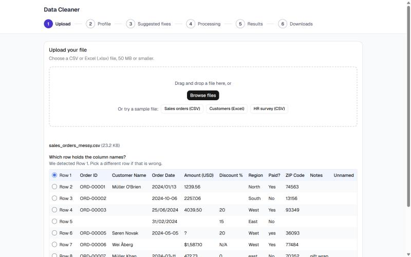
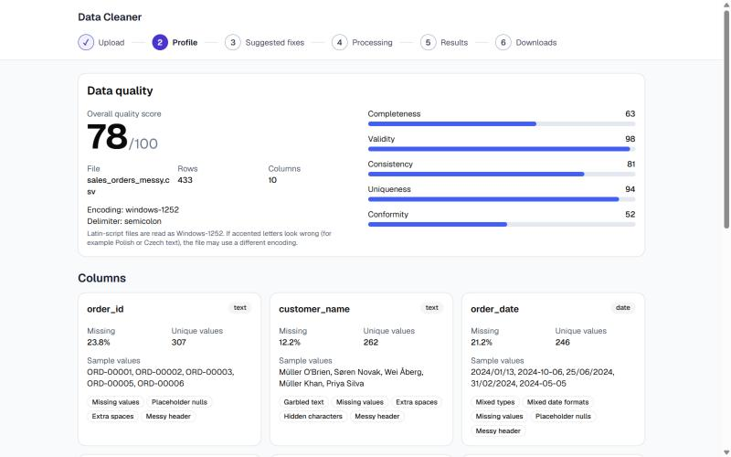
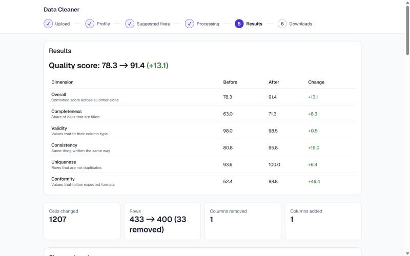
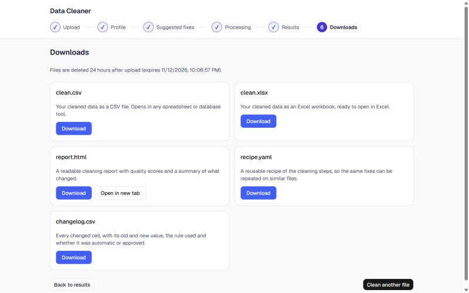

# Data Cleaner

Upload a messy CSV or Excel file. Get back a clean file, a cleaning report, a reusable recipe and a full change log.

> Status: Phase 1 (MVP) complete (milestones M0 to M5). No login and no AI features in this phase.

## What it does
1. **Upload** a `.csv` or `.xlsx` file (up to 50 MB).
2. **Profile**: per-column statistics and a 0 to 100 quality score.
3. **Suggest fixes**: safe fixes are applied automatically; judgment calls wait for your approval.
4. **Clean** in the background with a progress bar.
5. **Results**: before/after quality score and a filterable change log.
6. **Download** the clean file, HTML report, YAML recipe and change log.

## Architecture
```
frontend/ (React + TS + Vite + Tailwind + shadcn/ui)
    |  HTTP (JSON)
backend/  (FastAPI, BackgroundTasks, SQLite jobs table, ./storage)
    |  Python calls to engine.pipeline only
engine/   (Polars + DuckDB, 10 cleaning rules, zero web code)
```
Interfaces are defined in [docs/CONTRACT.md](docs/CONTRACT.md).

## Repo layout
| Path | Purpose |
|---|---|
| `engine/` | Pure Python cleaning engine: ingest, profile, rules, change log, recipe, report, pipeline |
| `backend/` | FastAPI app: routes, jobs table, storage, 24-hour cleanup |
| `frontend/` | React website (6-step flow) |
| `tests/` | Engine and API tests (pytest) |
| `sample_data/` | Messy test files and the error-injection script |
| `docs/` | CONTRACT.md, ADRs, BRD, user stories, process maps |
| `.claude/agents/` | The 5 helper agents |

## Setup
Requirements: Python 3.12, Node 20 or newer.
```bash
python -m venv .venv
.venv/Scripts/activate                 # Windows (Git Bash: source .venv/Scripts/activate); macOS/Linux: source .venv/bin/activate
pip install -e ".[backend,dev]"
pytest -q                              # 239 tests, about 80 seconds
uvicorn backend.main:app --port 8000   # backend; API docs at http://localhost:8000/docs
```
In a second terminal:
```bash
cd frontend
npm install
npm run dev                            # http://localhost:5173 (proxies /api to port 8000)
npm run test -- --run                  # frontend tests
```
Uploads are kept for 24 hours under `./storage` (change with `DC_STORAGE_DIR`). Use "Try a sample file" on the first screen, or upload your own `.csv` / `.xlsx` (up to 50 MB).

## Screenshots
| Upload (header-row check) | Profile |
|---|---|
|  |  |

| Suggested fixes | Results (per dimension) |
|---|---|
|  |  |

| Downloads | Mobile (375 px) |
|---|---|
|  |  |

## Success criteria
Phase 1 is judged on three things, not on one average score (see [CONTRACT.md section 11](docs/CONTRACT.md)):
1. **Per-dimension lift:** no quality dimension drops after cleaning, and each dimension that has injected errors goes up.
2. **Recall on injected errors:** the share of injected, fixable errors that the cleaning fixed.
3. **Zero damaged cells:** no cell that had no injected error changes meaning.

## Evaluation results
Method: `sample_data/make_samples.py` injects known errors into three synthetic files and writes every one to `sample_data/ground_truth.csv` (3,057 entries). `evaluation/run_evaluation.py` profiles each file, approves every suggested fix, cleans, and compares the output with the ground truth. Full tables: [evaluation/RESULTS.md](evaluation/RESULTS.md).

| File | Quality before | After | Recall (fixable errors) | Precision | Damaged cells |
|---|---|---|---|---|---|
| sales_orders_messy.csv | 78.3 | 92.0 | 98.9% | 100% | 0 |
| customers_messy.xlsx | 91.5 | 99.2 | 98.7% | 100% | 0 |
| hr_survey_messy.csv | 86.3 | 96.1 | 98.6% | 100% | 0 |
| **All** | | | **98.8%** (1,721 of 1,742) | **100%** | **0** (5,890 cells compared) |

Per-dimension before to after (every proposal approved):

| Dimension | Sales | Customers | HR survey |
|---|---|---|---|
| Completeness | 63.0 to 71.3 | 96.7 to 97.5 | 75.9 to 84.3 |
| Validity | 98.0 to 98.5 | 99.2 to 99.7 | 96.7 to 100 |
| Consistency | 80.8 to 98.5 | 89.8 to 99.7 | 94.7 to 100 |
| Uniqueness | 93.6 to 100 | 97.7 to 100 | 98.2 to 100 |
| Conformity | 52.4 to 98.8 | 65.8 to 99.7 | 63.1 to 100 |

How to read the recall number: it only counts errors a rule is meant to fix. Of the 3,057 injected errors, the rest are not counted and are listed with their reasons in the results file: 795 missing values (cleaning cannot invent data), 306 ambiguous dates (the user must choose day-first or month-first), 60 case variants and 9 short typos in columns not treated as categories, 47 invalid values ("abc" in a number column, left as text and warned about), 41 stray markers, 28 placeholders such as "unknown", 23 category synonyms and 1 copied id. The weakest fixable types are exact duplicates (55.6%: some copies carry a missing value the original lacks, so they are no longer identical), outliers (66.7%: one extreme salary of 1 sits inside the statistical fence) and "(123)" amounts (1 of 5: the rule turns them into -123, while the ground truth expected +123; this is a disagreement between the injection and the contract's accounting convention, not a rule failure).

### A real public dataset (not in the evaluation)
Chicago Food Inspections, 5,000 rows, 17 columns, about 4.9 MB, City of Chicago open data, unmodified ([sample_data/DATASETS.md](sample_data/DATASETS.md)). It has no ground truth, so it is scored only before and after:

| | Before | After |
|---|---|---|
| Overall | 95.7 | 99.4 |
| Completeness | 97.7 | 97.7 |
| Validity | 100 | 100 |
| Consistency | 91.1 | 100 |
| Uniqueness | 100 | 99.9 |
| Conformity | 87.0 | 100 |

Uniqueness falls by 0.1: the long free-text column "violations" counts as a key candidate, and trimming merges values that differed only by spaces. No row was lost and no cell was damaged. This is listed as a known issue.

### Speed and memory
([evaluation/TIMING.md](evaluation/TIMING.md))

| Rows | File size | Profile | Clean | Total | Peak memory |
|---|---|---|---|---|---|
| 100,000 | 5.4 MB | 6 s | 17 s | 23 s | 405 MB |
| 872,050 | 47.5 MB | 47 s | 155 s | 201 s (3.4 min) | 2.0 GB |

Measured at M5. In M6 the file is read once (a Parquet cache shared by profile and clean), rules work on distinct values, and change records stream to disk: clean is 13 to 20% faster and the peak on a 47.5 MB file is 8% lower (1.8 GB). Writing clean.xlsx is still about half of the clean time. Details: [evaluation/TIMING.md](evaluation/TIMING.md).

**Supported file size:** up to 50 MB when run locally (about 4 to 5 minutes and 1.8 GB of memory at the top end), and 4 MB on the live site (Vercel's request limit is 4.5 MB; a 4 MB file is about 75,000 rows and takes well under a minute).

## Known limitations
- Latin-script files are read as Windows-1252. Central European files (Polish, Czech) may show wrong accented letters. The profile screen shows the detected encoding.
- Category merging does not catch swapped letters in short words ("Wset").
- Jobs run inside the API process; two big files at once slow each other.
- Change records are held in memory until written.

## Milestones
- [x] M0 Setup: structure, contract, agents
- [x] M1 Ingest, profile, quality score
- [x] M2 The 10 rules, change log, recipe, HTML report
- [x] M3 FastAPI backend with background jobs
- [x] M4 Website: 6 screens
- [x] M5 End-to-end test, evaluation, timing, mobile and keyboard check, review, final README

## Documents
- [Contract](docs/CONTRACT.md)
- [Architecture decisions](docs/adr/)
- [BRD](docs/BRD.md), [User stories](docs/USER_STORIES.md), [Process maps](docs/PROCESS_MAPS.md)
