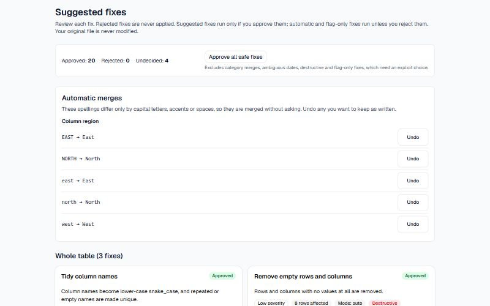
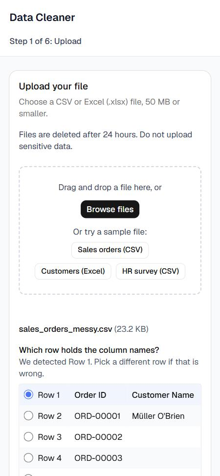

# Data Cleaner

Upload a messy CSV or Excel file. Get back a clean file, a cleaning report, a reusable recipe and a full change log.

> Status: Phase 1 (MVP) complete (milestones M0 to M5). No login and no AI features in this phase.

## What it does
1. **Upload** a `.csv` or `.xlsx` file (up to 50 MB).
2. **Profile**: per-column statistics and a 0 to 100 quality score.
3. **Suggest fixes**: safe fixes are applied automatically; judgment calls wait for your approval.
4. **Clean** in the background with a progress bar.
5. **Results**: before/after quality score and a filterable change log.
6. **Download** the clean file, HTML report, YAML recipe and change log.

## Architecture
```
frontend/ (React + TS + Vite + Tailwind + shadcn/ui)
    |  HTTP (JSON)
backend/  (FastAPI; jobs run in-process locally or through Vercel Queues; SQLite or Postgres; local disk or Vercel Blob)
    |  Python calls to engine.pipeline only
engine/   (Polars + openpyxl, 10 cleaning rules, zero web code)
```
Interfaces are defined in [docs/CONTRACT.md](docs/CONTRACT.md).

## Repo layout
| Path | Purpose |
|---|---|
| `engine/` | Pure Python cleaning engine: ingest, profile, rules, change log, recipe, report, pipeline |
| `backend/` | FastAPI app: routes, jobs table, storage, 24-hour cleanup |
| `frontend/` | React website (6-step flow) |
| `tests/` | Engine and API tests (pytest) |
| `sample_data/` | Messy test files and the error-injection script |
| `docs/` | CONTRACT.md, ADRs, BRD, user stories, process maps |
| `.claude/agents/` | The 5 helper agents |

## Setup
Requirements: Python 3.12, Node 20 or newer.
```bash
python -m venv .venv
.venv/Scripts/activate                 # Windows (Git Bash: source .venv/Scripts/activate); macOS/Linux: source .venv/bin/activate
pip install -e ".[backend,dev]"
pytest -q                              # about 450 tests, about 3 minutes
uvicorn backend.main:app --port 8000   # backend; API docs at http://localhost:8000/docs
```
In a second terminal:
```bash
cd frontend
npm install
npm run dev                            # http://localhost:5173 (proxies /api to port 8000)
npm run test -- --run                  # frontend tests
```
Uploads are kept for 24 hours under `./storage` (change with `DC_STORAGE_DIR`). Use "Try a sample file" on the first screen, or upload your own `.csv` / `.xlsx` (up to 50 MB).
For the demo with the sales sample, approve the Region suggestion on the fixes screen: west, WEST and West have no 80% majority spelling, so they become "West" only after you approve it.

## Deploying
Live URL: coming soon. The site will run on Vercel's free (Hobby) plan with Neon Postgres and Vercel Blob; see [docs/ADR-hosting-vercel.md](docs/ADR-hosting-vercel.md).

Backends are chosen by environment variables. Without them everything runs locally (SQLite, files under `./storage`):
- `DATABASE_URL` set: jobs and datasets live in Postgres.
- `DC_STORAGE_BACKEND=blob`: files live in a private Vercel Blob store.

The deployed function installs the `[project].dependencies` of `pyproject.toml` (`requirements.txt` holds the exact pins for local installs; no DuckDB, pandas, numpy or pyarrow; about 285 MB on Linux, limit 500 MB). `requirements-dev.txt` adds the test tools.

Production settings (Vercel environment variables; never commit their values):
| Variable | Value | Purpose |
|---|---|---|
| `DC_JOB_RUNNER` | `queue` | Run jobs through Vercel Queues (default `inprocess`) |
| `DC_STORAGE_BACKEND` | `blob` | Files in Vercel Blob (default `local`) |
| `DATABASE_URL` | set by the Neon integration | Postgres instead of SQLite |
| `DC_MAX_UPLOAD_MB` | `4` | Live upload limit (default 50 locally) |
| `CRON_SECRET` | a long random string | Protects the daily cleanup at `/api/cron/cleanup` |
| `DC_IP_HASH_SALT` | a long random string | Salt for the hashed IP counters (falls back to `CRON_SECRET`) |
| `DC_DAILY_JOB_CAP`, `DC_DAILY_IP_CAP` | 9, 6 (live site) | Daily job limits (whole site, per visitor). The per-visitor value never exceeds the site value |
| `DC_DAILY_UPLOAD_CAP`, `DC_DAILY_IP_UPLOAD_CAP` | 3, 2 (live site) | Daily upload limits (whole site, per visitor). The code default of 5 applies only with `DC_JOB_RUNNER=queue`; local runs have no site cap unless this is set. IPv6 visitors are grouped by /64 |
| `DC_STORAGE_LIMIT_MB` | 800 | New uploads are refused above this much stored data (Blob free store is 1 GB) |

On Vercel (`VERCEL_ENV` production or preview) the app refuses to start unless `DC_STORAGE_BACKEND=blob`, `DC_JOB_RUNNER=queue` and `DATABASE_URL` are set, so SQLite and local disk are never used there. `.env.example` lists every name with a placeholder.

One Vercel project serves everything: `vercel.json` builds `frontend/` into `site/`, which `backend.main` mounts at `/` behind every `/api/*` route (not `public/`: Vercel's Python builder leaves a build-made `public/` out of both the CDN and the function), `pyproject.toml` points Vercel at `backend.main:app` (the `/api/*` function, 300 s) and at the queue consumer `backend.worker`, `[project].dependencies` lists what the function installs, and `.vercelignore` keeps tests, docs, evaluation and sample generators out.

The first CLI deploy of a new Vercel project is always a production deploy, even without `--prod`.

`vercel.json` schedules the cleanup once a day (Vercel Cron, Hobby plan). Each job has a 240 second limit; a slower file fails with "This file took too long to process. Try a smaller file." Results and uploads are deleted after 24 hours. A link with `?d=...&j=...` reopens a job or its results until then.

## Screenshots
| Upload (header-row check) | Profile |
|---|---|
|  |  |

| Suggested fixes | Results (per dimension) |
|---|---|
|  |  |

| Downloads | Mobile (375 px) |
|---|---|
|  |  |

## Success criteria
Phase 1 is judged on these measures, not on one average score (see [CONTRACT.md section 11](docs/CONTRACT.md)):
1. **Detection recall:** the share of all injected errors the cleaner fixed, changed, flagged, listed as "left alone", or named as a problem for that column.
2. **Fix recall:** the share of all injected errors that end up correct and in the standard form. Deleted values cannot be restored, so this can never reach 100%.
3. **Precision and zero damaged cells:** changes must land on real errors, and no cell without an injected error may change meaning.
4. **Per-dimension lift:** no quality dimension drops after cleaning.

## Evaluation results
Method: `sample_data/make_samples.py` injects known errors into synthetic files and records every one in a `ground_truth.csv`. `evaluation/run_evaluation.py` profiles each file, approves every suggested fix, cleans, and compares the output with the ground truth. There are two batches:

- **Tuning batch** (`sample_data/`, 3 files): the files the cleaner was developed on.
- **Held-out batch** (`sample_data/heldout/`, 4 files): a different random seed, plus a store file whose region abbreviations (NE, SW, Ctr, N.E.) the cleaner was never tuned on. **This is the figure to quote.**

| Batch | Injected errors | Detection recall | Fix recall | Precision | Damaged cells |
|---|---|---|---|---|---|
| **Held-out** | 3,474 | **96.7%** (80.9% at the cell) | **69.1%** | 100% | 0 (7,281 cells compared) |
| Tuning | 2,718 | 97.3% (81.3% at the cell) | 66.9% | 100% | 0 (5,890 cells compared) |

Held-out batch per file:

| File | Quality before | After | Detection recall | Fix recall | Damaged cells |
|---|---|---|---|---|---|
| sales_orders_messy.csv | 77.8 | 91.9 | 99.9% | 73.8% | 0 |
| customers_messy.xlsx | 91.5 | 99.2 | 95.2% | 81.1% | 0 |
| hr_survey_messy.csv | 86.2 | 96.0 | 95.4% | 45.0% | 0 |
| store_visits_messy.csv (new) | 85.9 | 97.0 | 91.5% | 74.3% | 0 |

How to read these numbers:
- **What cannot be fixed.** 549 of the 1,073 unfixed held-out errors are deleted values: the cleaner reports them for the column but cannot invent data. 300 are ambiguous dates (03/04/2024): the cleaner asks the user for the day/month order. If the user picks the right order, fix recall is 77.7%. The HR file is low (45%) because all its dates are ambiguous.
- **What it misses.** Email addresses in capitals (66), "unknown" style placeholders (44), unparseable values such as "pending" in a date column (57, listed as left alone), stray markers (31), category synonyms such as "U.S.A." (17).
- **On the new store file:** "NE", "SW", "N.E." and "Cent." are merged correctly. "Northest" (4 rows) is left alone because it is equally close to Northeast and Northwest, and "Ctr" (2 rows) is not recognised as Central.
- "Detection at the cell" means the cleaner touched or listed that exact cell. The rest of detection is at column level, mostly "this column has missing values".
- Counting only the error types a rule is meant to fix (the M5 measure), recall is 99.7% on the held-out batch and 99.9% on the tuning batch. In M5 that figure was reported as 98.8%; the difference was two mistakes in the answer key, found and fixed in M6 ([evaluation/DIAGNOSIS.md](evaluation/DIAGNOSIS.md)).
- No quality dimension drops on any of the seven files. Full tables: [evaluation/RESULTS.md](evaluation/RESULTS.md).

### A real public dataset (not in the evaluation)
Chicago Food Inspections, 3,995 rows, 17 columns, 4.0 MB (the first 3,995 rows of a 5,000-row download; the kept bytes are unmodified, see [sample_data/DATASETS.md](sample_data/DATASETS.md)). It has no ground truth, so it is scored only before and after. The scores below were measured on the 5,000-row file; the trimmed file gives the same overall scores (95.7 and 99.4):

| | Before | After |
|---|---|---|
| Overall | 95.7 | 99.4 |
| Completeness | 97.7 | 97.7 |
| Validity | 100 | 100 |
| Consistency | 91.1 | 100 |
| Uniqueness | 100 | 99.9 |
| Conformity | 87.0 | 100 |

Uniqueness falls by 0.1: the long free-text column "violations" counts as a key candidate, and trimming merges values that differed only by spaces. No row was lost and no cell was damaged. This is listed as a known issue.

**Hand check.** 100 of its changes were drawn at random and read one by one, then the same 100 were checked again after two fixes in M6 step 8b ([evaluation/CHICAGO_HANDCHECK.md](evaluation/CHICAGO_HANDCHECK.md)):

| Verdict | Before (step 8) | After (step 8b) |
|---|---|---|
| Correct | 65 | 65 |
| Debatable ("CHICAGO" rewritten to "Chicago" against 99% of rows) | 31 | 0 |
| Useful flag | 1 | 1 |
| Useless flag (license numbers) | 3 | 0 |
| Wrong | 0 | 0 |
| No longer made | 0 | 34 |

A second, fresh sample of 100 changes (new seed, M6 step 9) was read the same way on the final engine: 98 correct, 2 useful flags, 0 debatable, 0 useless flags, 0 wrong. Both flags are O'Hare airport, a real location far west of the rest of the city.

The two fixes: a spelling used in 80% or more of its group now stays as written and the rare spellings follow it (Title Case is only suggested when there is no clear majority), and columns named like license, permit or number are treated as ids, so they get no outlier flags. The file now gets 11,840 changes instead of 17,347. The held-out and tuning numbers above did not move.

### Speed and memory
([evaluation/TIMING.md](evaluation/TIMING.md))

| Rows | File size | Profile | Clean | Total | Peak memory |
|---|---|---|---|---|---|
| 100,000 | 5.4 MB | 6 s | 17 s | 23 s | 405 MB |
| 872,050 | 47.5 MB | 47 s | 155 s | 201 s (3.4 min) | 2.0 GB |

Measured at M5. In M6 the file is read once (a Parquet cache shared by profile and clean), rules work on distinct values, and change records stream to disk: clean is 13 to 20% faster and the peak on a 47.5 MB file is 8% lower (1.8 GB). Writing clean.xlsx is still about half of the clean time. Details: [evaluation/TIMING.md](evaluation/TIMING.md).

**Supported file size:** up to 50 MB when run locally (about 4 to 5 minutes and 1.8 GB of memory at the top end), and 4 MB on the live site (Vercel's request limit is 4.5 MB; a 4 MB file is about 75,000 rows and takes well under a minute).

## Known limitations
- If you ran an earlier version locally, delete `storage/app.db` once: the old database layout is no longer migrated automatically.
- **Live site upload limit: 4 MB per file.** Vercel limits a request body to 4.5 MB. Local runs accept up to 50 MB.
- Latin-script files are read as Windows-1252. Central European files (Polish, Czech) may show wrong accented letters. The profile screen shows the detected encoding.
- Category merging does not catch swapped letters in short words ("Wset").
- **Live site daily limits:** 3 uploads and 9 jobs for the whole site, 2 uploads and 6 jobs per visitor, and 800 MB of stored files. Formula: 75% of the Blob free plan's 2,000 advanced operations a month is 1,500; one visit costs about 16 (11 puts, 5 lists, measured 2026-11-17: 73 on the dashboard after 3 full visits plus test uploads); 1,500 / 16 / 30 = 3 uploads a day. Jobs: 3 uploads x 3 jobs a visit (1 profile, up to 2 cleans) = 9. Over a limit the site says so and asks you to try again tomorrow.
- **Live site time limit:** 240 seconds per job.
- Locally, jobs run inside the API process; two big files at once slow each other.
- Change records are held in memory until written.

## Milestones
- [x] M0 Setup: structure, contract, agents
- [x] M1 Ingest, profile, quality score
- [x] M2 The 10 rules, change log, recipe, HTML report
- [x] M3 FastAPI backend with background jobs
- [x] M4 Website: 6 screens
- [x] M5 End-to-end test, evaluation, timing, mobile and keyboard check, review, final README

## Documents
- [Contract](docs/CONTRACT.md)
- [Architecture decisions](docs/adr/)
- [BRD](docs/BRD.md), [User stories](docs/USER_STORIES.md), [Process maps](docs/PROCESS_MAPS.md)
